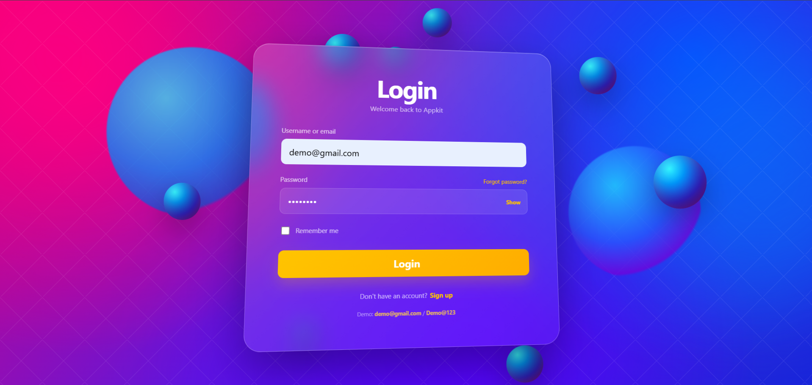
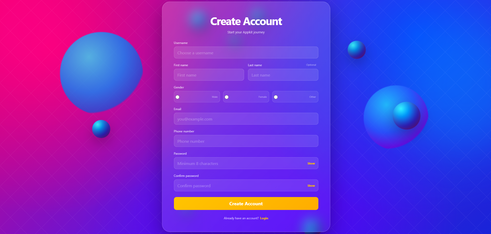
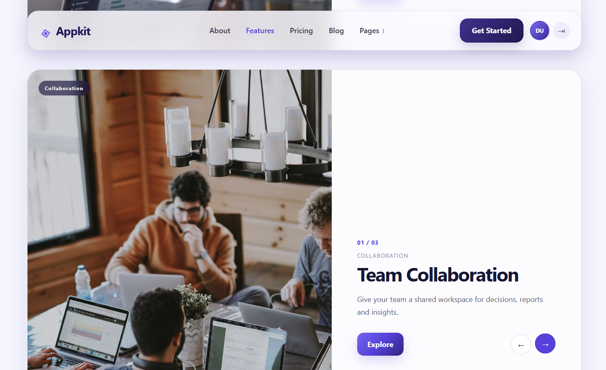

# React + Node/Express SPA








A scalable demo application with:

- React 19.2 + Vite
- React Router
- Node.js + Express
- Login with username/email + password
- Signup flow
- Demo account
- User persistence in `server/data/users.json`
- Protected routes
- Public routes
- Auth context
- Animated login/signup background
- Mouse-following login card tilt
- Card resets while form fields are focused
- Responsive landing page
- Features carousels
- Pricing cards
- Alternating blog layout
- Pages dropdown
- Profile initials + logout
- Separate CSS files

> IMPORTANT: This is a learning/demo authentication implementation. Passwords are intentionally stored in plain text because this project uses a JSON file instead of a real database. Do not deploy this authentication implementation to production.

## Project structure

```text
applit-app/
├── client/
│   ├── src/
│   │   ├── app/
│   │   ├── components/
│   │   ├── context/
│   │   ├── data/
│   │   ├── hooks/
│   │   ├── pages/
│   │   ├── services/
│   │   ├── styles/
│   │   └── main.jsx
│   └── package.json
├── server/
│   ├── src/
│   │   ├── controllers/
│   │   ├── routes/
│   │   ├── services/
│   │   ├── utils/
│   │   └── server.js
│   ├── data/
│   │   └── users.json
│   └── package.json
└── README.md
```

## Demo credentials

Username:
`demo`

Email:
`demo@gmail.com`

Password:
`Demo@123`

## Run the backend

```bash
cd server
npm install
npm run dev
```

API:
`http://localhost:5000`

Health check:
`http://localhost:5000/api/health`

## Run the frontend

Open another terminal:

```bash
cd client
npm install
npm run dev
```

Frontend:
`http://localhost:5173`

## Authentication flow

```text
/signup
   |
   | POST /api/auth/signup
   v
server/data/users.json
   |
   v
/login
   |
   | POST /api/auth/login
   v
AuthContext
   |
   v
/
```

## Production improvements

For production, replace the JSON file with a database, hash passwords using Argon2/bcrypt, and use secure server-side authentication/session handling.
